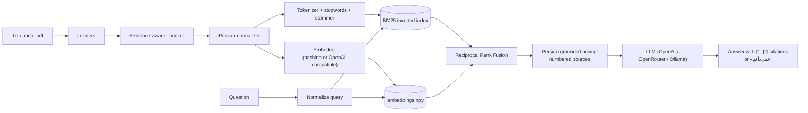

# persian-rag

[](https://github.com/ariaesm/persian-rag/actions/workflows/ci.yml)
[](LICENSE)
[](https://www.python.org/)

**Retrieval-Augmented Generation for Persian (Farsi) text.** Ask questions about your own
Persian documents and get answers from an LLM, grounded in retrieved passages, with
numbered citations — and a firm «نمی‌دانم» ("I don't know") when the documents don't say.

Generic RAG pipelines quietly fail on Persian: the same word can be stored as several
different byte sequences, so search misses documents that are right there. `persian-rag`
fixes that at the root with a from-scratch Persian normalizer, a Persian-aware tokenizer
and stemmer, BM25 + embedding hybrid retrieval, and a tiny dependency footprint
(**standard library + numpy**).

## Why Persian needs special handling

Persian text in the wild — scraped web pages, legacy Windows files, PDFs — mixes Arabic
and Persian code points, writes the zero-width non-joiner (ZWNJ, «نیم‌فاصله») in three
different ways, sprinkles diacritics and decorative elongation, and uses three digit
systems. Every row below shows two strings that *look* (almost) the same to a reader but
are different to a search engine; the right column is the output of
`persian-rag normalize`:

| Problem | Before | After |
|---|---|---|
| Arabic ي / ك instead of Persian ی / ک | `كتاب هاي  تاريخي` | `کتاب‌های تاریخی` |
| Verb prefix written with a space | `مي روم و نمي دانم` | `می‌روم و نمی‌دانم` |
| Suffix written with a space | `بزرگ ترين شهر ايران` | `بزرگ‌ترین شهر ایران` |
| ۀ (heh with yeh above) | `خانۀ ما` | `خانه‌ی ما` |
| Diacritics (اعراب) and tatweel (ـ) | `عِلْمٌ و سلامـــــت` | `علم و سلامت` |
| Persian / Arabic-Indic digits | `سال ۱۴۰۳ و ٢٠٢٤` | `سال 1403 و 2024` |
| Latin punctuation and quotes | `او گفت "سلام"  ,  رفت` | `او گفت «سلام»، رفت` |

A concrete failure from the sample corpus: the query
`روی سفره‌ی هفت‌سین چه چیزهایی می‌گذارند?` returns **zero** BM25 results without
normalization, because the document spells it `سفره ي هفت سين` (Arabic yeh, spaces
instead of ZWNJ). With normalization it is the top hit.

## Features

- **Persian normalizer** (from scratch, fully configurable): Arabic → Persian letters
  (ي ى ك ة ۀ أ إ), diacritics and tatweel removal, digit unification (`en`/`fa`/`keep`),
  ZWNJ repair around می/نمی and ها/های/تر/ترین/اند…, Persian punctuation (، ؛ ؟ « »),
  whitespace cleanup, and NFKC folding of Arabic presentation forms that PDFs emit.
- **Tokenizer, stopwords, light stemmer**: ZWNJ-aware tokens, a hand-written stopword
  list, and a conservative stemmer (`کتاب‌ها` → `کتاب`, but `تنها` stays `تنها`).
- **Loaders**: `.txt`, `.md` (markup stripped) and `.pdf` (optional `pypdf`, imported
  lazily and skipped if missing). Text files fall back to Windows-1256 for legacy files.
- **Sentence-aware chunker**: splits on `. ! ? ؟` and newlines, packs whole sentences
  into chunks with token-based size and overlap.
- **Retrievers**: BM25 implemented from scratch; dense retrieval behind an `Embedder`
  protocol with an **offline `HashingEmbedder`** (hashed character n-grams) and an
  **OpenAI-compatible embeddings client**; **hybrid** fusion via Reciprocal Rank Fusion.
- **Persistent index**: `chunks.json` + `embeddings.npy` + `meta.json`.
- **Grounded answers**: OpenAI-compatible chat client built on `urllib` — works with
  OpenAI, OpenRouter or a local **Ollama**. Persian system prompt enforcing `[1]`, `[2]`
  citations and «نمی‌دانم» when unsupported.
- **CLI**: `ingest`, `search`, `ask`, `normalize`, `eval`.
- **Evaluation**: Recall@k and MRR for BM25 / embeddings / hybrid, with and without
  normalization.

## Pipeline



## Quickstart

Requires Python 3.11+.

```bash
git clone https://github.com/ariaesm/persian-rag.git
cd persian-rag
pip install -e .            # or: pip install -e ".[pdf,dev]"

# Build an index from the bundled sample corpus (offline, no API key needed)
persian-rag ingest examples/corpus --index ./index

# Retrieve passages
persian-rag search "زعفران کجا کشت می‌شود؟" --index ./index -k 3
```

### Python API

```python
from persian_rag.index import Index
from persian_rag.llm import ChatClient, LLMSettings
from persian_rag.loaders import load_documents
from persian_rag.normalizer import normalize
from persian_rag.pipeline import RAGPipeline

print(normalize("كتاب هاي تاريخي"))  # کتاب‌های تاریخی

index = Index.build(load_documents("examples/corpus"))
retriever = index.retriever("hybrid")  # or "bm25" / "dense"
for hit in retriever.search("حافظ در کدام شهر زندگی می‌کرد؟", k=2):
    print(f"{hit.score:.3f}", hit.chunk.id)

rag = RAGPipeline(retriever, ChatClient(LLMSettings.from_env()))
answer = rag.ask("حافظ در کدام شهر زندگی می‌کرد؟")
print(answer.text, answer.citations)
```

## CLI

```bash
# Normalize text (or pipe it on stdin); --digits fa|en|keep
persian-rag normalize "مي روم و نمي دانم"           # → می‌روم و نمی‌دانم
echo "سال ٢٠٢٤" | persian-rag normalize --digits fa  # → سال ۲۰۲۴

# Index files/directories; tune chunking; optionally use an embeddings API
persian-rag ingest ./docs --index ./index --chunk-size 120 --overlap 30
persian-rag ingest ./docs --index ./index --embedder openai --embedding-model text-embedding-3-small

# Search: hybrid (default), bm25 or dense; --json for machine-readable output
persian-rag search "متروی تهران چند خط دارد؟" --index ./index --mode bm25 -k 5

# Ask an LLM (reads PERSIAN_RAG_BASE_URL / PERSIAN_RAG_API_KEY / PERSIAN_RAG_MODEL)
export PERSIAN_RAG_API_KEY=sk-...
persian-rag ask "گل‌های زعفران در چه فصلی برداشت می‌شوند؟" --index ./index

# Evaluate retrieval on a QA set
persian-rag eval --corpus examples/corpus --qa examples/qa.jsonl -k 1 3 5
```

### Running fully locally with Ollama

No API key and no data leaves your machine. Pick a model with decent Persian support
(e.g. `qwen2.5` or `llama3.1`):

```bash
ollama pull qwen2.5:7b
export PERSIAN_RAG_BASE_URL=http://localhost:11434/v1
export PERSIAN_RAG_MODEL=qwen2.5:7b
persian-rag ask "قنات چیست و مادرچاه چه نقشی دارد؟" --index ./index

# Ollama also serves embeddings through the same API:
persian-rag ingest ./docs --index ./index --embedder openai --embedding-model bge-m3
```

See [`.env.example`](.env.example) for OpenAI and OpenRouter settings.

## Evaluation

`persian-rag eval` runs the 22 questions in [`examples/qa.jsonl`](examples/qa.jsonl)
against the 8 documents in [`examples/corpus/`](examples/corpus) and reports
document-level Recall@k and MRR. "Normalization off" means raw tokenization with no
character normalization and no stemming (stopwords still removed); "on" is the full
Persian chain. Embeddings are the offline `HashingEmbedder` (1024 dims, char 2–4-grams).

Measured output of `persian-rag eval` (chunk size 120, overlap 30):

| Retriever | Normalization | Recall@1 | Recall@3 | Recall@5 | MRR |
|---|---|---:|---:|---:|---:|
| BM25 | off | 0.909 | 0.955 | 0.955 | 0.924 |
| Hashing embeddings | off | 0.909 | 0.955 | 1.000 | 0.943 |
| Hybrid (RRF) | off | 0.909 | 0.955 | 1.000 | 0.943 |
| BM25 | on | 1.000 | 1.000 | 1.000 | 1.000 |
| Hashing embeddings | on | 1.000 | 1.000 | 1.000 | 1.000 |
| Hybrid (RRF) | on | 1.000 | 1.000 | 1.000 | 1.000 |

**Read this with care.** The corpus is tiny and purely illustrative: eight short
documents written for this project, five of which deliberately use the messy
orthography common in scraped Persian text (Arabic ي/ك, spaced or missing ZWNJ,
diacritics, tatweel, Arabic-Indic digits). With so few documents every configuration is
near the ceiling; the point is the *direction* of the effect — the misses without
normalization are exactly the orthographic mismatches described above — not the absolute
numbers. Use `persian-rag eval` with your own corpus and QA set for real conclusions.

## Project layout

```
src/persian_rag/
  normalizer.py   Persian normalization
  tokenizer.py    tokenizer, stemmer, Analyzer chain   (stopwords.py: word list)
  loaders.py      .txt / .md / .pdf loaders
  chunker.py      sentence-aware chunking
  retrieval.py    BM25, dense and hybrid (RRF) retrievers
  embeddings.py   HashingEmbedder, OpenAIEmbedder
  index.py        persistent index
  llm.py          OpenAI-compatible chat client      (http_client.py: urllib JSON helper)
  prompts.py      Persian grounded prompts
  pipeline.py     retrieve → prompt → answer with citations
  evaluation.py   Recall@k / MRR benchmark
  cli.py          command-line interface
```

## Development

```bash
make install   # pip install -e ".[dev]"
make check     # ruff check + ruff format --check + pytest
make eval      # reproduce the table above
```

Tests never touch the network: HTTP clients are exercised against a mocked `urlopen`.
See [CONTRIBUTING.md](CONTRIBUTING.md).

## Roadmap

- Optional [hazm](https://github.com/roshan-research/hazm) integration (lemmatizer,
  POS-aware ZWNJ fixing) behind the same `Analyzer` interface.
- Cross-encoder / LLM rerankers on top of hybrid retrieval.
- Streaming answers in `persian-rag ask`.
- Larger, public Persian QA benchmarks and multilingual embedding baselines (e.g. bge-m3).
- Incremental index updates and an approximate-nearest-neighbour backend for large corpora.
- Better sentence splitting (abbreviations, quotes) and Arabic-script OCR clean-up for PDFs.

## License

[MIT](LICENSE) © 2026 Aria Esmaeilzadeh

---

<div dir="rtl">

## خلاصه به فارسی

**persian-rag** یک ابزار متن‌باز برای «تولید پاسخ با بازیابی» (RAG) روی اسناد فارسی است:
اسناد خود را نمایه می‌کنید، پرسش می‌پرسید و مدل زبانی فقط بر اساس بخش‌های بازیابی‌شده
پاسخ می‌دهد، با ارجاع شماره‌دار مانند [1] و [2]؛ و اگر پاسخ در اسناد نباشد، می‌گوید
«نمی‌دانم».

چرا فارسی کار ویژه می‌خواهد؟ در متن‌های فارسی واقعی، «ي» و «ك» عربی به جای «ی» و «ک»،
فاصله به جای نیم‌فاصله، اعراب، کشیده (ـ) و سه نوع رقم دیده می‌شود. برای موتور جست‌وجو
این‌ها رشته‌های متفاوتی هستند و سند درست پیدا نمی‌شود. این پروژه یک نرمال‌ساز فارسی
از صفر، توکن‌ساز و ریشه‌یاب سبک، بازیابی BM25 و برداری و ترکیب آن‌ها با RRF را فراهم
می‌کند و فقط به کتابخانه‌ی استاندارد پایتون و numpy وابسته است.

- نرمال‌سازی: `persian-rag normalize "كتاب هاي تاريخي"`
- ساخت نمایه: `persian-rag ingest ./docs --index ./index`
- جست‌وجو: `persian-rag search "زعفران کجا کشت می‌شود؟"`
- پرسش و پاسخ با OpenAI، OpenRouter یا Ollama محلی: `persian-rag ask "..."`
- ارزیابی: `persian-rag eval`

پیکره‌ی نمونه کوچک و صرفاً برای نمایش است و همه‌ی متن‌های آن برای همین پروژه نوشته شده‌اند.

</div>
